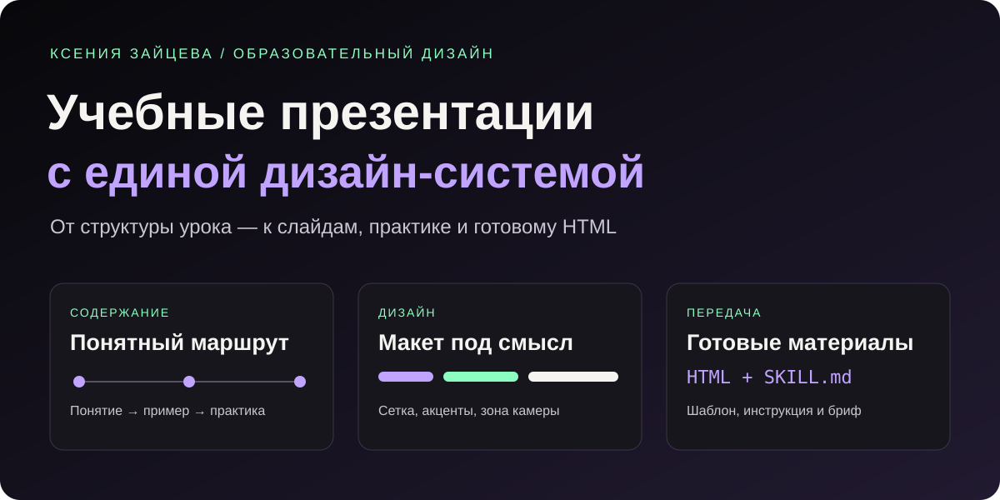

# Учебные презентации — дизайн, методика и AI-скилл

**Кейс Ксении Зайцевой · Образовательный дизайн · HTML/CSS/JavaScript · Работа с AI-агентом**

Система подготовки учебных презентаций для взрослой аудитории: от содержания урока до автономного HTML-файла. В проекте объединены методика, визуальные правила, готовый шаблон и скилл — инструкция для AI-агента, помогающая воспроизводить оформление в следующих уроках.

**[Посмотреть кейс](PORTFOLIO.md) · [Как использовать](USAGE.md) · [Скачать проект](https://github.com/KseniyaZaitseva1/zerocoder-presentation-design/archive/refs/heads/main.zip)**

## Задача

Подготовить серию понятных презентаций для записи учебных видео. Слайды должны отделять темы, показывать примеры, давать практические задания и оставлять место для камеры эксперта. Серия должна выглядеть цельно, а макеты — меняться в зависимости от содержания.

## Решение

| Часть проекта | Что она даёт |
| --- | --- |
| Методика содержания | Последовательность от понятия и примера к практике и проверке |
| Визуальная система | Общие цвета, типографику, сетку и правила анимации |
| HTML-шаблон | Навигацию, масштабирование и полноэкранный режим |
| Скилл для AI-агента | Повторно используемые инструкции для оформления новых уроков |
| Бриф и чек-лист | Понятный порядок постановки задачи и приёмки результата |

## Посмотреть результат

В репозитории есть **пример урока на 42 слайда** и **галерея из 10 реальных слайдов** с пояснениями. Галерея позволяет скачать каждый пример в PNG.

1. Скачайте проект через **Code → Download ZIP** и распакуйте архив.
2. Откройте `examples/gallery.html` — быстрый обзор оформления.
3. Откройте `examples/mcp-lesson.html` — полный пример презентации. Используйте стрелки, пробел и клавишу **F** для полноэкранного режима.

HTML работает локально без установки зависимостей и без сети. В интерфейсе GitHub HTML отображается как код; живая веб-версия отдельно не развёрнута.

## Что передаётся вместе с проектом

| Материал | Ссылка |
| --- | --- |
| Описание кейса для заказчика | [PORTFOLIO.md](PORTFOLIO.md) |
| Инструкция по использованию | [USAGE.md](USAGE.md) |
| Методика наполнения | [docs/content-guide.md](docs/content-guide.md) |
| Цвета, шрифты, сетка и макеты | [docs/design-system.md](docs/design-system.md) |
| Процесс работы и критерии приёмки | [docs/workflow.md](docs/workflow.md) |
| Готовый скилл | [SKILL.md](skills/codex-course-slide-design/SKILL.md) |
| HTML-шаблон скилла | [deck.html](skills/codex-course-slide-design/assets/deck.html) |
| Пояснения к скиллу | [docs/skill-guide.md](docs/skill-guide.md) |
| Бриф учебного материала | [templates/lesson-brief.md](templates/lesson-brief.md) |
| Бриф для заказчика | [templates/client-brief.md](templates/client-brief.md) |
| Примеры оформления | [examples/gallery.html](examples/gallery.html) |
| Полная HTML-презентация | [examples/mcp-lesson.html](examples/mcp-lesson.html) |

## Особенности оформления

- Тёмная сцена 1600 × 900, светлый текст, мятные и сиреневые акценты.
- Свободная область справа сверху для камеры эксперта.
- Разделители тем, схемы, таблицы, разборы примеров и задания.
- Один мягкий переход всего слайда; содержание видно сразу.
- Одна практика — один слайд с шагами и промптом. Подробные инструкции готовятся отдельно для конкретного урока.
- Изображения встроены в HTML: файл можно передавать целиком.

## Что этот кейс демонстрирует

Структурирование учебного материала, разработку визуальной системы, сборку автономной презентации, упаковку правил в скилл и подготовку документации. Решения и ограничения разобраны в [описании кейса](PORTFOLIO.md).

## Проверки и границы

Пример презентации и галерея проверены локально в браузере: навигация, загрузка изображений, скачивание PNG, работа без сети и отображение в уменьшенном окне. Публикуемые файлы проверены на секреты; контрольные суммы — в [manifest.json](manifest.json).

Это проект по дизайну и методике, не официальный продукт OpenAI. Возможности сервисов внутри учебного примера нужно проверять перед новой записью урока. Слайд с личной биографией эксперта исключён из публичного примера. Закрытые рабочие документы и настройки подключений не публикуются.

Автор — **[Ксения Зайцева](https://github.com/KseniyaZaitseva1)**. Для обсуждения нового проекта используйте [бриф заказчика](templates/client-brief.md).
